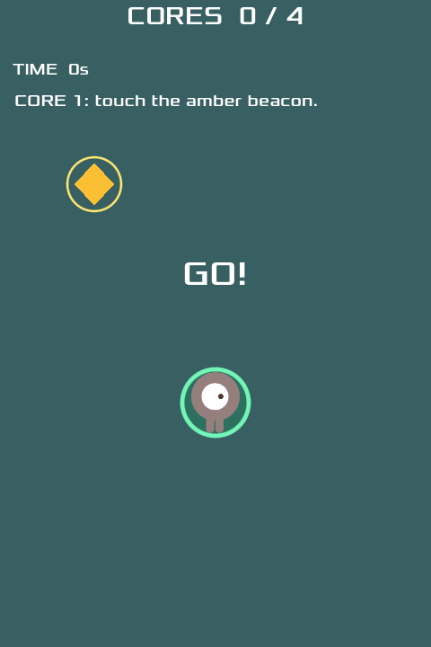

# Beacon Relay — Game Factory batch 02

A small complete playable Godot game using mature upstream components rather
than a new game engine or isolated LEGO work.

## Player goal

With WASD or arrow keys, collect four amber cores and return each one to the
green depot without touching drifting enemies. Carrying reduces speed; later
deliveries increase enemy frequency. Deliver all four to win. Any collision
loses. Both endings offer REPLAY. The game has a beginning, repeated action
loop, risk, progression, result and retry.

    godot --path examples/beacon-relay
    mise run test:beacon
    mise run factory:package:beacon

## Real component reuse

Upstream official Godot 4.7 sample Dodge the Creeps commit:
b761b4cd5718a7118f2c95eb55f181d0a5f004f1.
Original Player, Mob, source sprites, animation, sound and Godot InputMap
are preserved. Adapted root and HUD scripts and native Scenes; added a
game-specific RelayPlan Resource and drawn depot/beacons. No registry,
simulation substitute, custom renderer, or generic Game workflow engine.

Licenses differ across the upstream source, font, music and artwork.
Read bundled LICENSE, fonts/LICENSE.txt and CREDITS.txt; these are included
in both native distributable technical-preview archives.

test:beacon drives the real player using the native InputMap and four whole
collect/deliver cycles, verifies the win, creates a real upstream physics
enemy collision for loss, and then checks retry. The factory builds Linux
and Windows binaries using Godot 4.7.2 official export templates, including
a Linux native smoke. Physical Windows operation and actual Human experience
are not certified by a Linux export job.

Actual Godot-rendered 480x720 production-batch preview (not a mockup):

